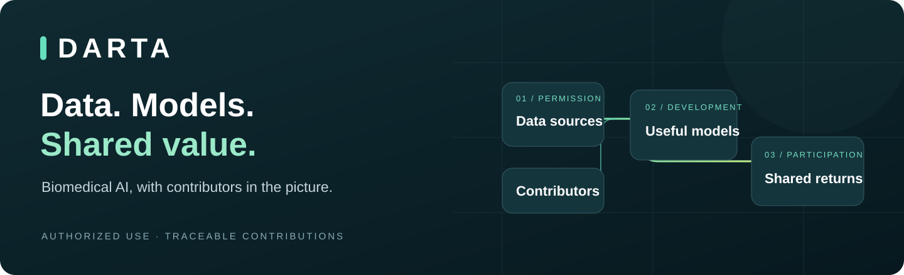
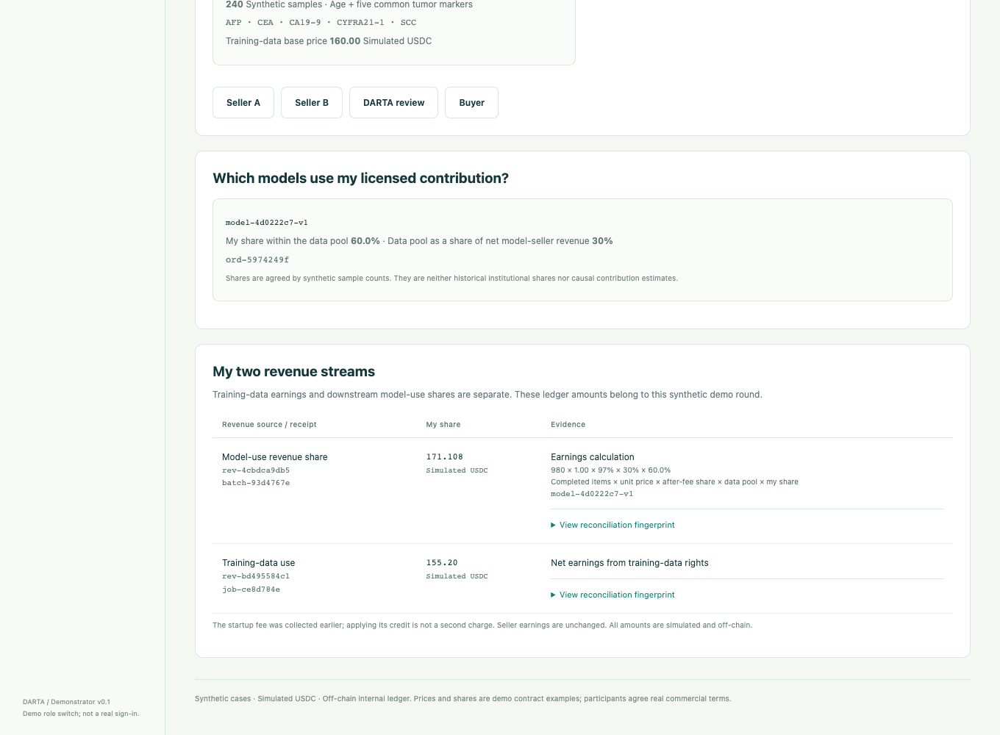

# DARTA

**Build useful models. Share the value with data contributors.**

DARTA is building a marketplace for authorized biomedical data use, model development, and shared returns. Our purpose is to help teams build with valuable data and enable data contributors to share in the value those models create under clear, agreed terms.

**[See the MRSA assessment example](MRSA.md) · [Explore the workflow demo](docs/walkthrough.md) · [Discuss a project](docs/collaborate.md) · [繁體中文](README.zh-TW.md)**

> **Available today:** a working local demonstration with synthetic data and simulated USDC. Explore the workflow and discuss how it could fit your team.

## Who we are building for

| Your role | What DARTA is designed to help you do |
|---|---|
| **Data contributors** — hospitals, laboratories, research groups | Define authorized uses, connect your contribution to released models, and understand your agreed earnings. |
| **Model developers** — researchers, diagnostics and biotech teams | Agree data-use rights, train and evaluate models, and establish how contributors share qualifying model revenue. |
| **Teams commissioning model work** | Start with a research question and discuss a scoped project covering suitable authorized data, standard training, and an evaluation report. |

Start with your scientific and business needs. Discuss the use case, permissions, deliverables, and costs in plain language.

## Understand data quality before choosing your scope

DARTA's planned seller-data review helps buyers understand provenance, completeness, usable volume and fit for their research question before agreeing how much data use to license. Sellers gain a clear way to explain the strengths and limitations of their data.

The **[MRSA assessment example](MRSA.md)** shows how a fictional pool of 10,000 records becomes 8,000 usable records, how class coverage affects an initial quantity estimate, and how a subsequent model study could guide expansion. All figures are illustrative; they are not results from an available dataset or evidence of a deployed assessment service.

**[Explore the quality report and quantity calculation →](MRSA.md)**

## Two ways data contributors can participate

**Training-data use.** Agree a price and a defined use of your data for model work.

**Downstream model revenue.** Agree a share of qualifying model revenue, linked to the specific model version and its recorded contributors.

These are separate revenue streams. Prices, rights, allocation rules, and qualifying revenue are agreed for each project.

*Local synthetic demo: fictional contributors and illustrative sharing terms. All earnings are simulated USDC recorded off-chain.*

## From a research question to shared value

1. **Describe the goal.** Agree the intended use, scope, deliverables, and evaluation plan.
2. **Review and authorize.** Review data quality and task fit, agree the usable scope, and record permissions and costs.
3. **Train and evaluate.** Run an approved standard task and review the report before approving the model release.
4. **Connect the contributors.** Record which data versions support that model and the agreed revenue-sharing rule.
5. **Use and reconcile.** Account for completed, authorized model use and allocate the agreed shares.

The product direction is controlled data use without raw-data downloads to buyers, with seller-controlled storage as the preferred architecture. The current synthetic demo runs locally; seller-side execution is still to be implemented.

## See the workflow in action

The [guided walkthrough](docs/walkthrough.md) follows a fictional biomedical research project from request to seller earnings:

- A buyer defines the project and applies a startup-fee credit.
- Two fictional contributors authorize synthetic data for a standard training task.
- An actual small classifier is trained and evaluated on synthetic records.
- A model-use batch reserves funds, settles completed items, and releases unused funds.
- Each contributor can inspect their own earnings and the calculation behind them.

The demonstration includes a partial-failure scenario and repeated-request handling: failed items are not charged, and replaying the same request does not create another charge.

**[Walk through the buyer and seller views →](docs/walkthrough.md)**

## Current availability

| Area | Availability |
|---|---|
| **Working demonstration** | Source review, authorization, synthetic training and evaluation, model/source records, startup-fee credit, hosted batch accounting, and contributor allocations. |
| **Payment status** | Simulated USDC in an off-chain internal ledger. Real payments are not enabled. |
| **Deployment status** | Local demonstration. Institutional authentication, seller-controlled execution, payment integration, and production security remain to be built and validated. |

The demonstration uses fictional parties and synthetic data. It does not represent a customer transaction or clinical validation. Real cooperation requires agreed rights, privacy, security, and commercial arrangements.

## Let's discuss your use case

Tell us **what you want to build**, **what authorized data you can contribute**, or **which part of the workflow matters to your team**.

Start with your role, a non-confidential use case, the broad data type, and the outcome you want to explore. The [collaboration guide](docs/collaborate.md) explains what to share and answers common questions.

**[Start a collaboration conversation →](https://github.com/HsinYaoWang/DARTA/issues/new?template=collaboration.yml)**

GitHub issues are public. Please do not post datasets, patient information, credentials, or confidential contracts.
