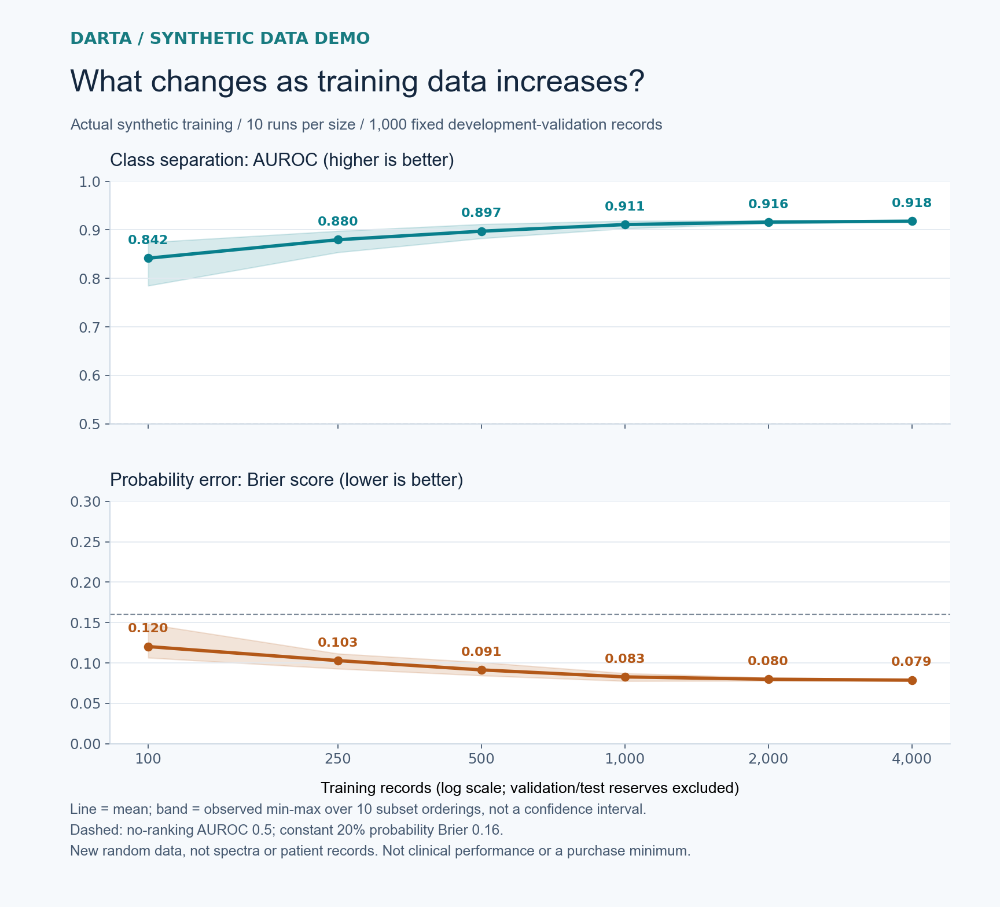
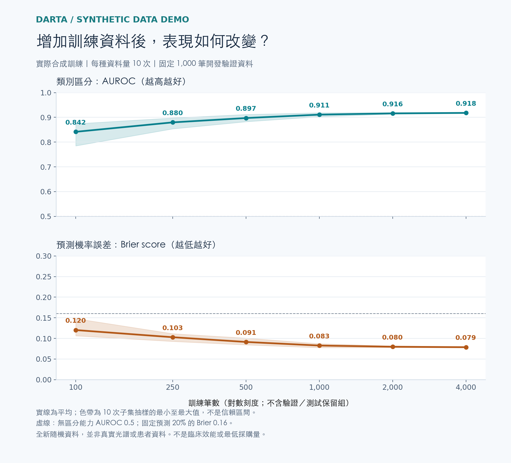

# MRSA learning-curve demo: what was measured

[Back to the MRSA example](../MRSA.md) · [Aggregate results (CSV)](mrsa-learning-curve-summary.csv) · [繁體中文](#繁體中文)

**Measured on 13 October 2026 using entirely generated data.** This is an MRSA-inspired purchasing conversation, not a model trained on real MRSA cases. There are no patient records, actual spectra, hospital distributions or historical model results in this experiment.

## A consistent comparison

| Part of the experiment | Scope |
|---|---|
| Generated records | 8,000 independent synthetic entities, with generic numeric features and a constructed binary label. Each cohort has 20% positives by design. |
| Training pool | 6,000 records. Compare nested subsets of 100, 250, 500, 1,000, 2,000 and 4,000 records. Training counts exclude the evaluation reserves. |
| Development-validation cohort | The same separate 1,000 records for every curve point: 200 positives and 800 negatives. Used to examine learning gains. |
| Final-test reserve | A separate 1,000 generated records: 200 positives and 800 negatives. Not used for training, predictions, scoring or choosing a quantity. |
| Repeated runs | 10 predetermined training-subset orderings; each larger subset contains the smaller subset from that ordering. Class mix stays at 20%. All 60 results are included. |
| Demonstration model | A generic logistic-regression baseline. Standardization is fitted only on each training subset. The model settings and quantity grid are fixed before running. |
| Plotted variation | Mean and observed minimum–maximum across the 10 subset orderings, on one fixed development-validation cohort. Not confidence intervals or independent population replications. |

The 8,000 generated entities are a separate experiment. They do not validate the hypothetical 10,000 → 8,000 screening funnel in the overview. There is no simulation of actual spectroscopy, cross-hospital transfer, related-patient sampling or clinical reference testing here.

## Read more than one performance measure

**AUROC** describes ranking/class separation; higher is better. **Brier score** measures mean squared probability error; lower is better. Brier reflects more than calibration alone. A constant 20% prediction has Brier 0.16 on this constructed 20%-positive validation cohort.

At the fixed illustrative probability threshold **0.5**, the mean classification results are:

| Training records | Synthetic-positive sensitivity | Synthetic-negative specificity |
|---:|---:|---:|
| 100 | 50.05% | 93.04% |
| 250 | 58.05% | 93.46% |
| 500 | 60.70% | 94.46% |
| 1,000 | 63.10% | 95.64% |
| 2,000 | 63.85% | 96.12% |
| 4,000 | 65.65% | 96.25% |

Sensitivity uses the same 200 positive records and specificity the same 800 negative records in each run. Every validation record receives a prediction; there is no no-call rule. The threshold is a demonstration setting, not a clinical operating point. The [CSV](mrsa-learning-curve-summary.csv) includes all four metrics' means and observed ranges.

## What a buyer can conclude

From 2,000 to 4,000 training records, mean AUROC increases **0.00189** and mean Brier falls **0.00109**. Paired changes across the 10 orderings range from **−0.00165 to +0.00443 AUROC**, and **−0.00222 to +0.00018 Brier**. Some runs worsen; this is not a significance test or a guaranteed benefit.

These results support a discussion of incremental benefit versus the next batch's cost and coverage. They do not select an optimal order, establish sufficient data or measure the value of a real seller's contribution. Real work needs its own protocol, source/subgroup analysis, independent evaluation and agreed rights and price.

General metric and evaluation background: [learning curves](https://scikit-learn.org/stable/modules/learning_curve.html#learning-curve), [avoiding preprocessing leakage](https://scikit-learn.org/stable/common_pitfalls.html#data-leakage), and [Brier score](https://scikit-learn.org/stable/modules/generated/sklearn.metrics.brier_score_loss.html). These explain standard methods; they are not endorsements of DARTA or evidence of clinical validity.

**[Discuss your data requirements →](collaborate.md)**

---

## 繁體中文

### 這條曲線實際量測了什麼

**2026 年 10 月 13 日，以全新生成的合成資料完成。** MRSA 是用來說明需求的情境名稱，並非以真實 MRSA 病例訓練。沒有使用患者紀錄、真實光譜、醫院分布或歷史模型結果。

- **8,000 個獨立合成實體：** 一般數值特徵與人工建構的二元標籤，各組陽性比例固定 20%。
- **6,000 筆訓練池：** 取 100、250、500、1,000、2,000、4,000 筆比較，不把驗證／測試保留組算進訓練量。
- **固定 1,000 筆開發驗證組：** 每個點都用同一組 200 陽性、800 陰性紀錄，檢視資料量增加的效果。
- **另留 1,000 筆最終測試組：** 同樣 200 陽性、800 陰性；本次不拿來訓練、預測、計分或決定數量。
- **10 組事先固定的子集順序：** 每組中，大子集包含小子集，陽性占比維持 20%；60 次結果全部納入。
- **一般邏輯迴歸展示模型：** 每次只以該訓練子集擬合標準化處理；模型設定與數量比較表在執行前固定。

這 8,000 筆是獨立的合成實驗，沒有驗證前頁假設的 10,000 → 8,000 品質篩選。也沒有模擬真實光譜、跨醫院移轉、相關患者取樣或臨床參考檢驗。

實線是平均，色帶是固定開發驗證組上 10 次子集順序的最小至最大值，**不是信賴區間**，也不代表更換臨床族群的不確定性。

### 除了 AUROC，還看什麼

AUROC 描述排序／類別區分能力，越高越好；Brier score 是預測機率的平均平方誤差，越低越好，並不只量測校準。這個陽性占比 20% 的驗證組，若全部固定預測 20%，Brier 為 0.16。

以固定示範機率門檻 **0.5** 分類，各訓練量的平均敏感度／特異度如下。每次分母分別是同一組 200 陽性／800 陰性；每筆都產生預測，沒有 no-call 機制。

| 訓練筆數 | 合成陽性敏感度 | 合成陰性特異度 |
|---:|---:|---:|
| 100 | 50.05% | 93.04% |
| 250 | 58.05% | 93.46% |
| 500 | 60.70% | 94.46% |
| 1,000 | 63.10% | 95.64% |
| 2,000 | 63.85% | 96.12% |
| 4,000 | 65.65% | 96.25% |

門檻不是臨床操作標準。[彙總 CSV](mrsa-learning-curve-summary.csv) 保留四項指標的平均及各次範圍。

### 如何連到採購討論

從 2,000 增至 4,000 筆，平均 AUROC 增加 **0.00189**、Brier 下降 **0.00109**；10 組配對變化範圍分別為 AUROC **−0.00165 至 +0.00443**、Brier **−0.00222 至 +0.00018**。部分結果略降；這不是顯著性檢定，也不是新增資料必然有效的承諾。

這份證據可以協助討論下一批的成本、涵蓋範圍與增量效益；沒有替真實賣方估價、選出最佳訂單或證明資料已足夠。正式工作仍須依本案評估設計、來源／子群分析、獨立驗證及雙方權利與價格約定進行。

**[討論你的資料需求 →](collaborate.md#繁體中文)**
