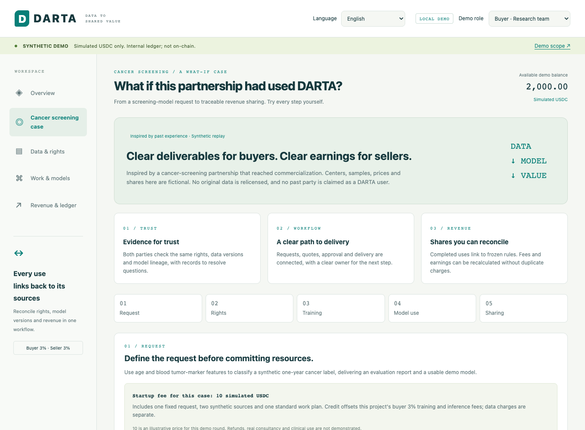
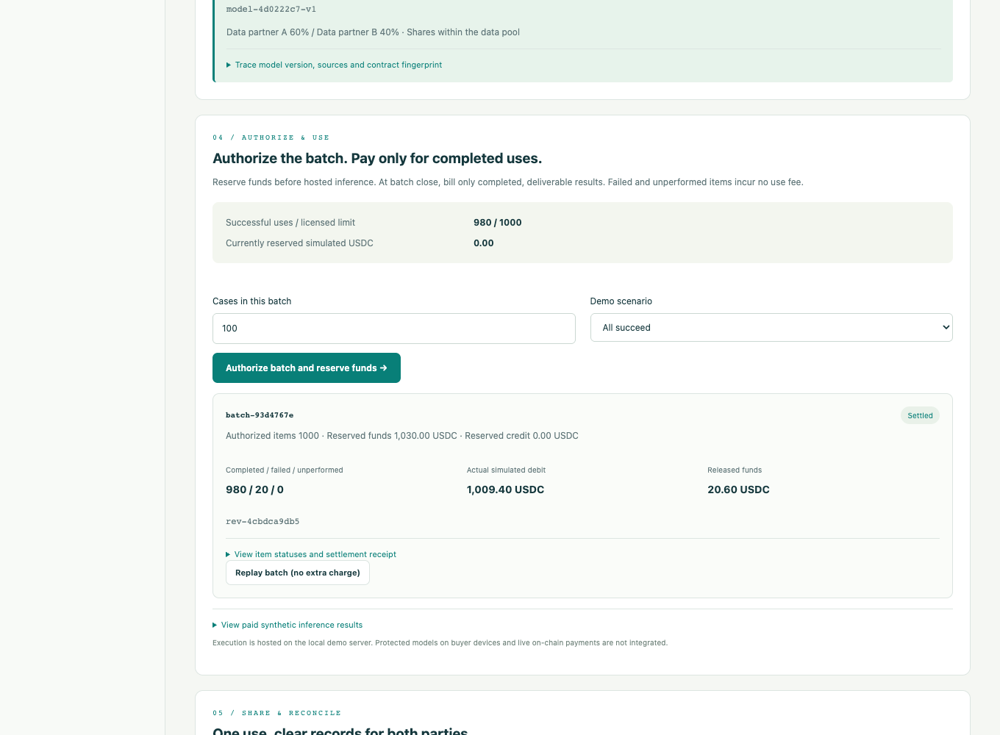

# From authorized data to shared returns

[DARTA](../README.md) · [Discuss a project](collaborate.md) · [繁體中文](#繁體中文)

Follow a biomedical research project through the buyer's and contributor's views. The point of this walkthrough is to make three things clear: **what is authorized, what is delivered, and how the agreed returns are calculated.**

> **Product demonstration:** These are screenshots of DARTA's working local demonstrator, captured in October 2026. Participants, data, prices and sharing terms are fictional. USDC balances are simulated and recorded in an off-chain ledger. This is a guided product preview; a public self-service application is not available yet.

## 1. Start with the research question

A fictional buyer requests a cancer-screening research model. The project view brings together the intended use, work scope, source review, authorization, model evaluation and later use. Two fictional research sources contribute independently generated synthetic data.

*Local synthetic demonstration. No original patient records, customer names or private agreements are used.*

## 2. Agree the work before it starts

The buyer reviews the permitted purpose, deliverables, data-use prices and sharing terms. The demonstrator fixes those terms for the authorized work and records the project startup fee as credit against the same project's buyer transaction fees.

The next step runs an actual small classifier on synthetic data, produces an evaluation report, and requires a separate model approval. The released model is linked to its source versions and agreed allocation rule. Synthetic model metrics demonstrate execution; they do not establish clinical performance.

## 3. Pay for completed use

In this example, the buyer authorizes a batch of 1,000 items. Funding is reserved first. The selected partial-failure scenario completes 980 items and fails 20; settlement charges completed items and releases the unused reserve. Replaying the same request returns the original receipt without a second charge.

| Example batch | Simulated USDC |
|---|---:|
| Reserved before execution | 1,030.00 |
| Charged for 980 completed items | 1,009.40 |
| Unused reserve released | 20.60 |

*Illustrative price: 1 simulated USDC per completed item, with a 3% buyer fee. These figures are demonstration terms, not a commercial quote or a record of real payments.*

## 4. Understand the contributor's earnings

The contributor view separates **training-data-use income** from **later model-use revenue sharing**. Each amount connects to the contributor's source, the model version and the terms used to calculate it.

For fictional contributor A, this batch's model-use allocation is:

**980 completed items × 1 × 97% after the seller-side fee × 30% contributor pool × 60% source share = 171.108 simulated USDC.**

The 30% pool and 60% share are illustrative agreed weights. They do not establish a standard contract or measure the source's causal economic value.

## What this preview demonstrates

The local workflow connects source review, authorization, synthetic training, model approval, batch completion and reproducible simulated allocations. It includes startup-fee credit, failed-item handling and duplicate-request protection.

Real institution authentication, seller-controlled execution, live USDC payments, on-chain settlement and protected local model delivery remain to be integrated and validated. The demonstration does not establish clinical validity or production privacy protections. Revenue generated outside a DARTA-controlled payment path requires authenticated reporting or agreed audit evidence.

**[Discuss how this workflow could fit your project →](collaborate.md)**

---

## 繁體中文

### 從資料授權到收益共享

這個案例讓買方與資料提供者看清楚三件事：**授權了什麼、交付了什麼、收益如何依約計算。** 上方畫面來自 2026 年 10 月的本地展示版；機構、資料、價格與分配比例均為虛構，USDC 是記錄在鏈外帳本的模擬金額。目前提供產品展示，尚未開放公開自助交易。

1. **提出需求。** 虛構買方提出癌症篩檢研究模型需求，確認用途與工作範圍；兩個虛構研究來源提供獨立生成的合成資料。
2. **先約定，再執行。** 確認授權、價格、交付與分潤條款；啟動費可折抵同案買方交易費。展示版實際訓練合成分類模型、產生評估報告，再核准模型並固定來源與分配規則。合成模型指標不代表臨床效能。
3. **按完成使用結算。** 範例預留 1,030 模擬 USDC；1,000 筆中完成 980 筆、失敗 20 筆，實扣 1,009.40，釋放未使用的 20.60。同一請求重送不重複扣款。
4. **看懂兩種收入。** 資料提供者分別核對訓練使用收入與後續模型分潤。範例 A 的模型使用分配為：980 × 1 × 97% × 30% × 60%＝171.108 模擬 USDC。

所有價格、資料池比例與來源權重都只是展示條款，不是正式報價、固定分潤承諾或因果價值估計。真實機構登入、賣方控制的運算環境、USDC 支付、鏈上結算與受保護的本地模型交付仍待整合驗證；平台外收入也需要可驗證的回報或約定的稽核證據。

**[聊聊這個流程如何用在你的專案 →](collaborate.md#繁體中文)**
